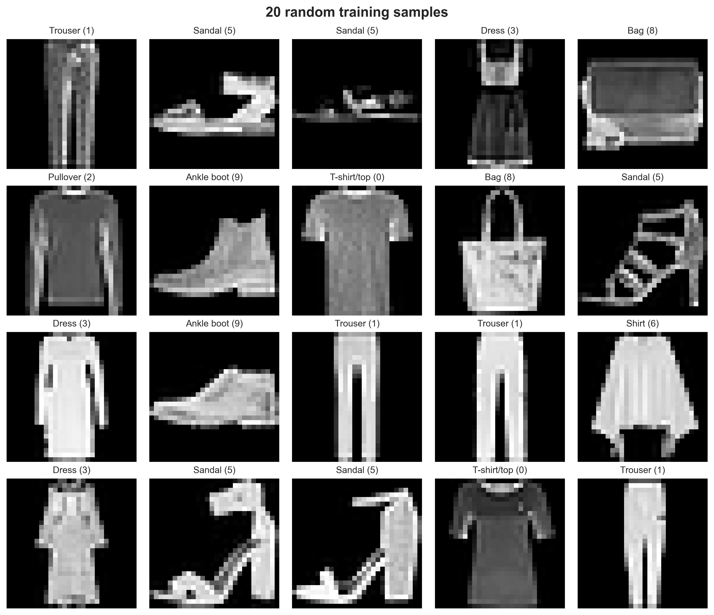
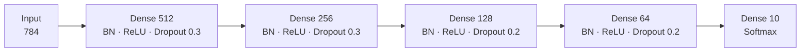
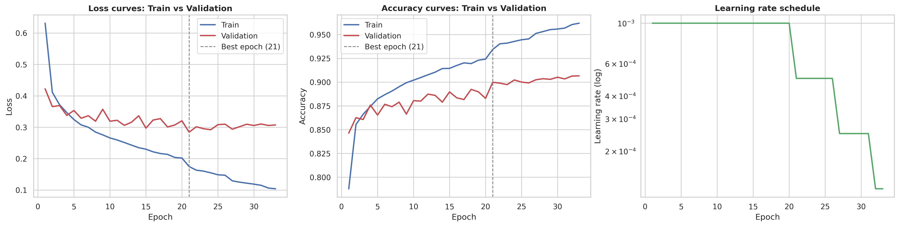
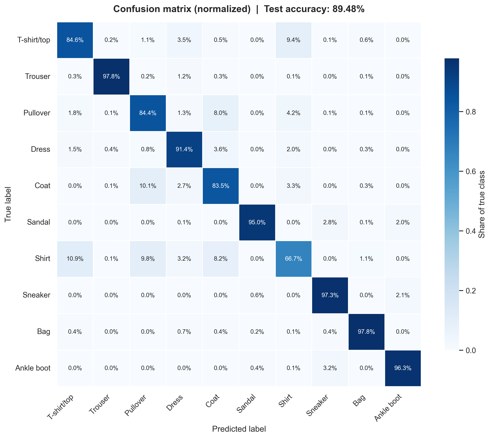
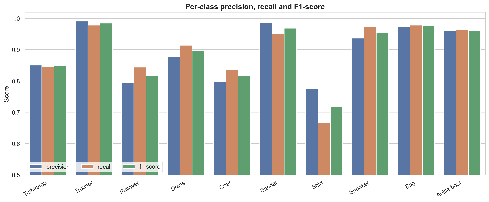
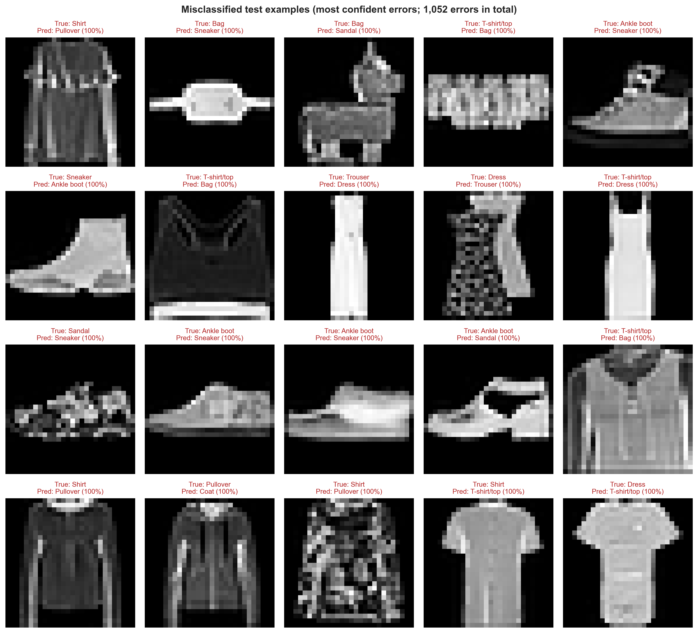

<div align="center">

# High-Accuracy Deep Neural Network Image Classifier

**A fully connected network (no CNNs) for Fashion-MNIST, engineered to beat overfitting with Batch Normalization, Dropout, and Early Stopping.**

[](https://github.com/mohammedashraaff25-code/DNN-Image-Classifier/actions/workflows/ci.yml)
[](https://www.python.org/)
[](https://www.tensorflow.org/)
[](https://keras.io/)
[](https://scikit-learn.org/)
[](#results)
[](LICENSE)

[Overview](#overview) •
[Features](#key-features) •
[Dataset](#dataset) •
[Architecture](#model-architecture) •
[Results](#results) •
[Quick Start](#installation-and-usage)

</div>

---

## Overview

Image classification is usually the home turf of convolutional networks. This project takes the opposite challenge: **how far can a plain stack of fully connected (dense) layers go on [Fashion-MNIST](https://github.com/zalandoresearch/fashion-mnist), and how do we keep such a high-capacity model from simply memorizing the training set?**

The answer is a carefully regularized deep neural network that combines:

- **Batch Normalization** to stabilize and speed up training
- **Dropout** to stop neurons from co-adapting
- **Early Stopping + learning-rate scheduling** to halt training at the right moment and keep the best weights

The result is a **578K-parameter MLP that reaches 89.48% test accuracy** after about 3 minutes of training, built as a clean, modular, and reproducible pipeline: data loading, training, evaluation, inference, and a systematic hyperparameter study.

| At a glance | |
|---|---|
| **Test accuracy** | **89.48%** |
| **Parameters** | 577,930 |
| **Training time** | about 3 minutes (Apple Silicon GPU) |
| **Architecture** | 784 → 512 → 256 → 128 → 64 → 10 |
| **Convolutions used** | None |

> **Honest context:** 89 to 90% is the typical range for well-tuned fully connected networks on Fashion-MNIST. Convolutional networks usually reach the low 90s or higher because they exploit the 2D structure of images. This project deliberately stays within dense layers so the focus is on **generalization techniques**, not on architecture tricks.

---

## Key Features

- **Pure fully connected design.** No convolutional layers anywhere; the model code even asserts this in its self-test.
- **Overfitting toolkit.** Batch Normalization, graded Dropout, He initialization, Early Stopping with best-weight restoration, `ReduceLROnPlateau`, and checkpointing of the best model.
- **Leak-free evaluation.** A stratified 85/15 train/validation split is used for all decisions; the test set is touched only for the final report.
- **Reproducible.** Fixed seeds everywhere, a deterministic stratified split (exactly 900 validation images per class), and pinned dependencies.
- **Complete pipeline.** Separate, documented modules for data, model, training, evaluation, and inference, each runnable from the command line.
- **Rich evaluation.** Classification report, raw and normalized confusion matrices, per-class metrics, and a gallery of the model's most confident mistakes.
- **Systematic experiments.** A notebook comparing 7 architectures, 6 dropout rates, and 5 learning rates, with a multi-seed robustness check.
- **Predict on your own photos.** Custom images are converted to Fashion-MNIST format automatically (grayscale, square padding, 28x28, color inversion).
- **Apple Silicon ready.** Uses `tensorflow-metal` for GPU acceleration on M-series Macs.
- **Tested.** A pytest suite of 75 unit and end-to-end tests (data loading, architecture, callbacks, evaluation, inference, and a full train → evaluate → predict smoke test) runs offline in about a minute and on every push through GitHub Actions.
- **Clean code.** Type hints, docstrings, Ruff linting, and Black formatting throughout.

---

## Dataset

[Fashion-MNIST](https://github.com/zalandoresearch/fashion-mnist) is a drop-in replacement for MNIST made of **70,000 grayscale images (28x28 pixels)** of Zalando clothing articles in **10 balanced classes**. It is harder than digit recognition, because many garments look alike.

| Label | Class | Label | Class |
|:---:|---|:---:|---|
| 0 | T-shirt/top | 5 | Sandal |
| 1 | Trouser | 6 | Shirt |
| 2 | Pullover | 7 | Sneaker |
| 3 | Dress | 8 | Bag |
| 4 | Coat | 9 | Ankle boot |

**Splits used in this project**

| Split | Images | Purpose |
|---|---:|---|
| Train | 51,000 | Fitting the weights |
| Validation | 9,000 (900 per class) | Early stopping, checkpointing, model selection |
| Test | 10,000 (1,000 per class) | Final, untouched evaluation |

**Preprocessing** (see `src/data_loader.py`): images are flattened from `(28, 28)` to `(784,)` and scaled from `[0, 255]` to `[0, 1]`. The exploratory analysis in [`notebooks/01_EDA.ipynb`](notebooks/01_EDA.ipynb) confirms that the classes are perfectly balanced, so no resampling or class weighting is needed.

<p align="center">
  
</p>

> The dataset is downloaded automatically by Keras on first use.
> Citation: Xiao, Rasul, Vollgraf. *Fashion-MNIST: a Novel Image Dataset for Benchmarking Machine Learning Algorithms*, 2017 ([arXiv:1708.07747](https://arxiv.org/abs/1708.07747)).

---

## Model Architecture

The network is a Keras `Sequential` model. Every hidden block follows the same pattern:

```
Dense  →  BatchNormalization  →  ReLU  →  Dropout
```



| Block | Output | Parameters |
|---|:---:|---:|
| Input (flattened image) | 784 | 0 |
| Dense + BatchNorm + ReLU + Dropout(0.3) | 512 | 403,456 |
| Dense + BatchNorm + ReLU + Dropout(0.3) | 256 | 132,096 |
| Dense + BatchNorm + ReLU + Dropout(0.2) | 128 | 33,280 |
| Dense + BatchNorm + ReLU + Dropout(0.2) | 64 | 8,448 |
| Dense + Softmax | 10 | 650 |
| **Total** | | **577,930** (576,010 trainable) |

**Design choices**

- **Tapering widths (512 → 64)** compress the representation step by step, from raw pixels down to class evidence.
- **Graded dropout (0.3 → 0.2).** Wider early layers are the most prone to memorization, so they get the stronger dropout.
- **He-normal initialization** is matched to ReLU activations and keeps gradients healthy in a deep stack.
- **Bias-free dense layers.** Each dense layer is followed by BatchNorm, whose learnable shift makes the bias redundant.
- **Softmax output with sparse categorical cross-entropy**, trained with the **Adam** optimizer (initial learning rate 1e-3).

The architecture is fully configurable: depth, width, and dropout are plain arguments of `build_model(hidden_units=..., dropout_rates=...)` in [`src/model.py`](src/model.py).

---

## Techniques Used to Prevent Overfitting

A deep dense network has far more capacity than 51,000 images need, so it will memorize them unless it is restrained. Five complementary mechanisms keep it honest:

| Technique | What it does | Settings |
|---|---|---|
| **Batch Normalization** | Normalizes layer inputs, which stabilizes training and adds a mild regularizing noise | After every Dense layer |
| **Dropout** | Randomly disables neurons during training so none can rely on specific partners | 0.3, 0.3, 0.2, 0.2 |
| **Early Stopping** | Stops training when validation loss stops improving and restores the best epoch | patience 12, `restore_best_weights=True` |
| **ReduceLROnPlateau** | Halves the learning rate when validation loss stalls, allowing finer convergence | factor 0.5, patience 5, min 1e-6 |
| **Model Checkpointing** | Saves the model with the lowest validation loss, so the best version survives even if training is interrupted | `models/best_model.keras` |

Supporting practices: a **stratified validation set** for every decision, **He initialization**, and **never using the test set** for tuning or model selection.

---

## Results

### Performance

Final metrics of the saved best model (epoch 21 of 33; Early Stopping ended the run at epoch 33 and restored the epoch-21 weights):

| Split | Loss | Accuracy |
|---|:---:|:---:|
| Train | 0.1351 | 95.00% |
| Validation | 0.2844 | 89.99% |
| **Test** | **0.3164** | **89.48%** |

- Validation and test accuracy differ by only **0.5 points**, so the validation-based model selection did not overfit the validation set.
- A train/test gap of about 5 points remains. That is expected for a high-capacity dense network, and the regularization stack keeps it contained.
- Of the 10,000 test images, **1,052 are misclassified**.
- Training took about **3.2 minutes** on an Apple Silicon GPU.

### Training curves

Loss and accuracy for train vs. validation, with the best epoch marked and the learning-rate schedule shown on the right.

<p align="center">
  
</p>

### Confusion matrix

Each row shows how the images of one true class were classified (values are shares of that class). Errors concentrate on classes that genuinely look alike, all of them upper-body garments. The five most frequent confusions are Shirt → T-shirt/top (109 images), Coat → Pullover (101), Shirt → Pullover (98), T-shirt/top → Shirt (94), and Shirt → Coat (82).

<p align="center">
  
</p>

### Per-class metrics and mistakes

<p align="center">
  
</p>

Trouser (F1 0.98), Bag (0.98), Sandal (0.97), Ankle boot (0.96), and Sneaker (0.95) are classified almost perfectly. **Shirt is the hardest class** (F1 0.72, recall 66.7%), followed by Coat (0.82), Pullover (0.82), and T-shirt/top (0.85). Macro-averaged F1 is 0.894.

The model's most confident mistakes are often ambiguous even to a human eye:

<p align="center">
  
</p>

The full classification report is saved in [`reports/classification_report.txt`](reports/classification_report.txt), and all numbers are available as JSON in [`reports/evaluation_metrics.json`](reports/evaluation_metrics.json).

### Hyperparameter experiments

[`notebooks/02_Experiments.ipynb`](notebooks/02_Experiments.ipynb) runs a greedy, one-factor-at-a-time search under one fixed protocol (batch size 256, Early Stopping, no scheduler):

| Phase | Explored |
|---|---|
| 1. Depth and width | 7 architectures, from 1 layer of 256 units to 6 layers |
| 2. Dropout | 0.0 to 0.5 |
| 3. Learning rate | 1e-2 to 1e-4 |
| 4. Robustness | Top candidates re-trained with 3 random seeds |

Models are selected on **validation accuracy only**, and test accuracy is reported as the final confirmation. The best configuration found, a single hidden layer of 256 units (dropout 0.3, learning rate 1e-4), reached **88.66% ± 0.17%** test accuracy (mean over 3 seeds) with only 204K parameters, about a third of the main model's size. These runs use a lighter protocol than `src/train.py`, so their numbers are not directly comparable to the 89.48% above. Together they show that most of the accuracy comes from the regularized design rather than from sheer depth.

All runs are saved in [`reports/experiment_results.csv`](reports/experiment_results.csv).

---

## Project Structure

```
DNN-Image-Classifier/
├── src/
│   ├── config.py             # Project paths (models/, reports/, figures/)
│   ├── data_loader.py        # Load, flatten, normalize, stratified train/val split
│   ├── model.py              # build_model(): configurable fully connected DNN
│   ├── train.py              # Training pipeline with callbacks, plots, checkpointing
│   ├── evaluate.py           # Test metrics, classification report, confusion matrices
│   ├── predict.py            # Inference on test samples or your own images
│   └── utils.py              # Seeding and figure-saving helpers
├── tests/                    # pytest suite (unit tests + end-to-end smoke test)
├── notebooks/
│   ├── 01_EDA.ipynb          # Exploratory data analysis
│   └── 02_Experiments.ipynb  # Architecture / dropout / learning-rate study
├── reports/
│   ├── figures/              # All generated plots
│   ├── training_history.csv
│   ├── training_config.json
│   ├── classification_report.txt
│   ├── evaluation_metrics.json
│   ├── experiment_results.csv
│   └── best_config.json
├── models/                   # Trained model (best_model.keras), created by training
├── .github/workflows/ci.yml  # Lint, format check and tests on every push
├── Makefile                  # make train / evaluate / test / lint / format / check
├── pyproject.toml            # Black, Ruff and pytest configuration
├── requirements.txt          # Runtime dependencies (pinned)
├── requirements-dev.txt      # + pytest, Black, Ruff
├── LICENSE
└── README.md
```

---

## Installation and Usage

### Requirements

- Python **3.11** (3.12 is not supported by the pinned TensorFlow version)
- Works on macOS, Linux, and Windows. `requirements.txt` picks the right TensorFlow package for your platform automatically: `tensorflow-macos` + `tensorflow-metal` (Metal GPU) on Apple Silicon, and the standard `tensorflow` package everywhere else.

### 1. Clone and set up the environment

```bash
git clone https://github.com/mohammedashraaff25-code/DNN-Image-Classifier.git
cd DNN-Image-Classifier

python3.11 -m venv venv
source venv/bin/activate

pip install --upgrade pip
pip install -r requirements.txt
```

Check that TensorFlow works (on Apple Silicon you should see a `GPU` device in the list):

```bash
python -c "import tensorflow as tf; print(tf.__version__, tf.config.list_physical_devices())"
```

### 2. Train

```bash
python -m src.train
```

Useful options:

```bash
python -m src.train --epochs 150 --batch-size 256 --learning-rate 0.0005 --patience 15
```

This creates `models/best_model.keras`, `reports/training_history.csv`, and the training curves in `reports/figures/`.

### 3. Evaluate

```bash
python -m src.evaluate
```

Prints the test loss and accuracy and the full classification report, then writes the confusion matrices, per-class chart, misclassified examples, and JSON/CSV/TXT reports to `reports/`.

### 4. Predict

```bash
# Random images from the test set (shows predicted vs. true label)
python -m src.predict --test-samples 10

# Your own photos (PNG or JPG of a clothing item on a plain background)
python -m src.predict --image path/to/item.jpg
```

Custom images are converted to Fashion-MNIST format automatically. If a prediction looks wrong, try `--invert yes` or `--invert no`. The model was trained on small, centered, studio-style product pictures, so cluttered photos will be less accurate.

### 5. Explore the notebooks

```bash
jupyter lab
```

### 6. Run the tests

```bash
pip install -r requirements-dev.txt   # adds pytest, Black, Ruff

make test      # run the test suite
make check     # lint + formatting check + tests (what CI runs)
```

The tests use a small random stand-in for Fashion-MNIST, so they run offline and do not download anything. Run `make help` to see all available shortcuts.

---

## Technologies Used

| Category | Tools |
|---|---|
| Language | Python 3.11 |
| Deep learning | TensorFlow 2.15, Keras (Sequential API), `tensorflow-metal` |
| Data and numerics | NumPy 1.26, pandas 2.2 |
| Visualization | Matplotlib 3.8, seaborn 0.13 |
| Evaluation | scikit-learn 1.4 |
| Images | Pillow |
| Notebooks | JupyterLab |
| Quality | pytest, Black, Ruff, GitHub Actions |

---

## Future Improvements

- [ ] **Add a CNN baseline** on the same pipeline to quantify exactly what convolutions add over the MLP
- [ ] **Stronger regularization:** L2 weight decay, label smoothing, and input augmentation (random shifts)
- [ ] **Smarter schedules:** cosine decay or one-cycle learning-rate policies
- [ ] **Automated hyperparameter search** with Keras Tuner or Optuna, covering interactions between factors that the greedy search cannot see
- [ ] **Ensembling** several seeds to reduce variance and gain accuracy
- [ ] **Calibration analysis** (reliability diagrams) to check whether the confidence scores can be trusted
- [ ] **Deployment:** export to TFLite or ONNX and build a small Streamlit demo
- [ ] **Type checking** with mypy and a pre-commit hook that runs the linters before every commit

---

## Author

**Mohamed Ashraf**

[](https://github.com/mohammedashraaff25-code)

<!-- Add your LinkedIn / email here, for example:
[](https://www.linkedin.com/in/your-profile)
-->

---

<div align="center">

If you found this project useful, consider giving it a ⭐

Released under the [MIT License](LICENSE).

</div>
